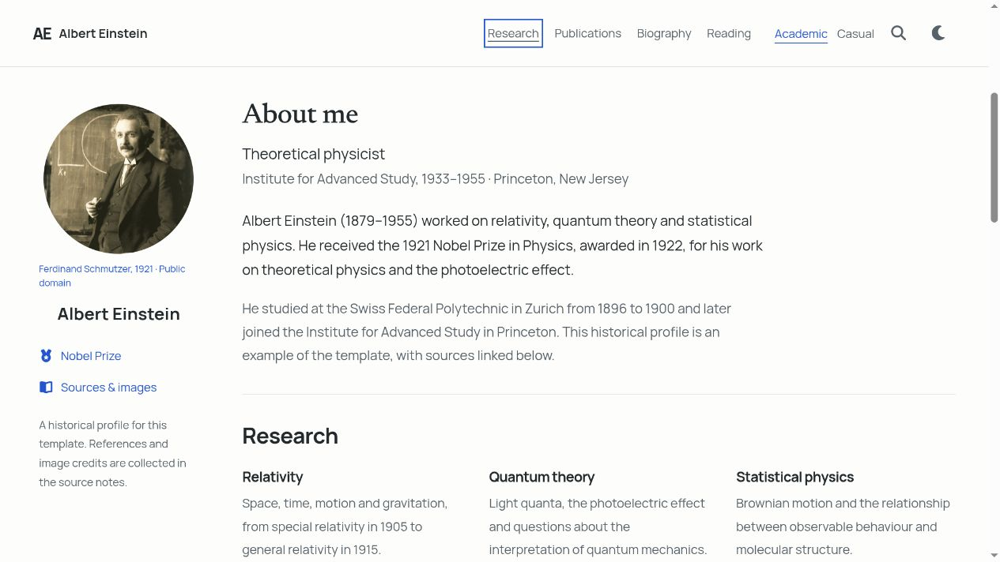

This is the reusable template behind my current homepage. It offers Academic and Casual presentations over shared content, with independently configurable portraits, contact links, section order and homepage selections.

## Content and presentation

Projects, posts, current focus, profile information and bibliography entries live in the content repository. The Astro and Vue components live in the template repository. A pinned template revision makes the build reproducible across the two repositories.

The template supports responsive profile sidebars, optional feature banners, light and dark themes, search, heading permalinks, tables of contents and Giscus comments. External navigation links keep independently hosted sites, such as my Blog, accessible from either mode.

## Publishing and examples

GitHub Actions builds review previews and publishes the site. Optional LaTeX configuration maps source documents to public PDF paths, including independently labelled language editions of a CV.

The cover is a local browser capture of the bundled historical Albert Einstein example. Its historical content and image credits remain documented in the template's [source notes](https://github.com/zzxzzk115/academic-casual-template/blob/eff77bad83aaca2dd8f50c2b9e4775ff51def8b1/examples/einstein/content/posts/sources.md). It is example content rather than my own research.
