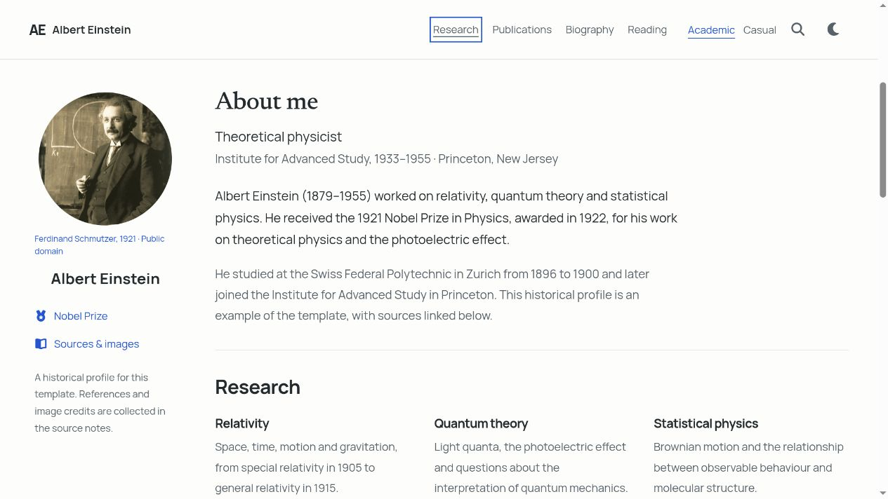

这是我现在这个主页背后的可复用模板。同一份内容可以用 Academic 和 Casual 两种方式展示，头像、联系方式、栏目顺序和首页放哪些内容，两种模式都能分开配置。

## 内容与展示

项目、文章、当前关注、个人资料和参考文献条目都放在内容仓库里，Astro 和 Vue 组件则放在模板仓库里。内容仓库固定引用模板的某个版本，所以跨两个仓库的构建也能复现。

模板支持响应式的个人资料侧边栏、可选的题图横幅、亮色和暗色主题、搜索、标题永久链接、目录和 Giscus 评论。导航栏里还可以放外部链接，这样不管在哪种模式下，都能跳到单独托管的站点，比如我的博客。

## 发布与示例

GitHub Actions 负责构建预览供审阅，再把网站发布出去。LaTeX 配置是可选的，可以把源文档对应到公开的 PDF 路径上，包括分别标好语言的几个版本的简历。

封面是在本地浏览器里截的模板自带示例，内容是历史人物 Albert Einstein。示例里的史料和图片出处都记在模板的 [来源说明](https://github.com/zzxzzk115/academic-casual-template/blob/eff77bad83aaca2dd8f50c2b9e4775ff51def8b1/examples/einstein/content/posts/sources.md) 里。这只是示例内容，不是我自己的研究。
