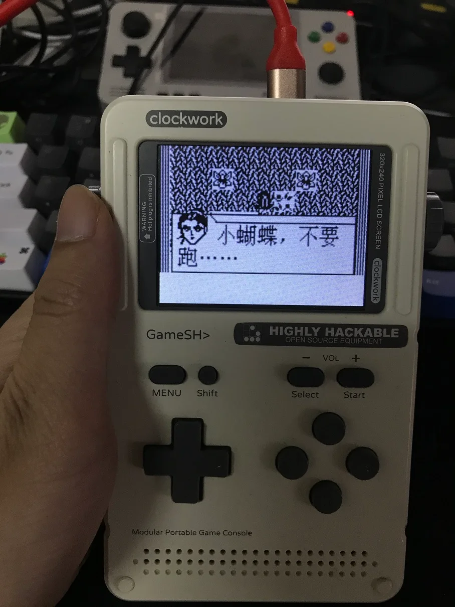

A GameShell adaptation of classic BBK handheld games based on [cyanzhong's bbk.emu](https://github.com/cyanzhong/bbk.emu).

The project packages the emulator for GameShell and provides launcher integration. The underlying emulator, game content and contributed icons retain their original authorship.

A related project is my [WQX NC1020 adaptation](/projects/wqx-gameshell/).
