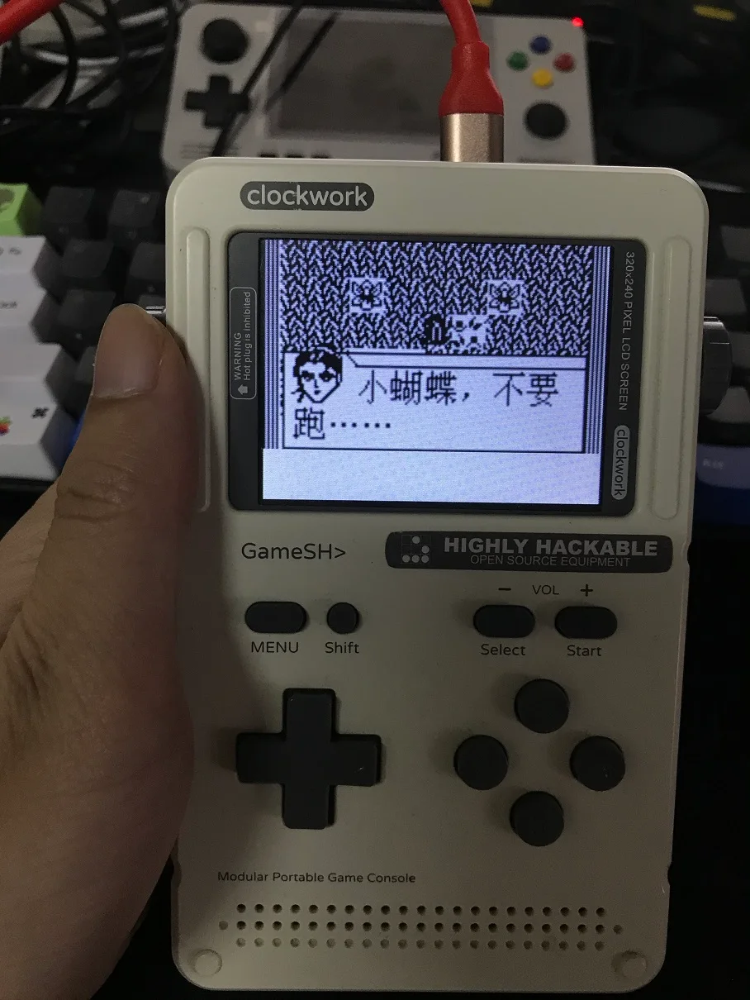

基于 [cyanzhong 的 bbk.emu](https://github.com/cyanzhong/bbk.emu)，把经典的步步高掌机游戏适配到 GameShell 上。

这个项目把模拟器打包到了 GameShell 上，并接入了启动器。底层的模拟器、游戏内容和别人贡献的图标，作者仍是原作者。

相关的还有我的 [文曲星 NC1020 适配](/projects/wqx-gameshell/)。
