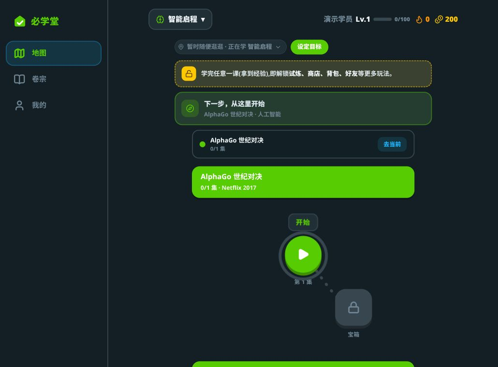

Bixuetang is a self-study application for Chinese-speaking learners. It organizes open courses into learning paths with prerequisites and keeps track of completed lessons.

Features include timestamped video notes, vocabulary review, spaced repetition, quizzes and progress rewards. The course index is mainly drawn from [csdiy.wiki](https://csdiy.wiki/), with videos from public course providers.

Source code and setup instructions are available in the repository under GPL-3.0.
