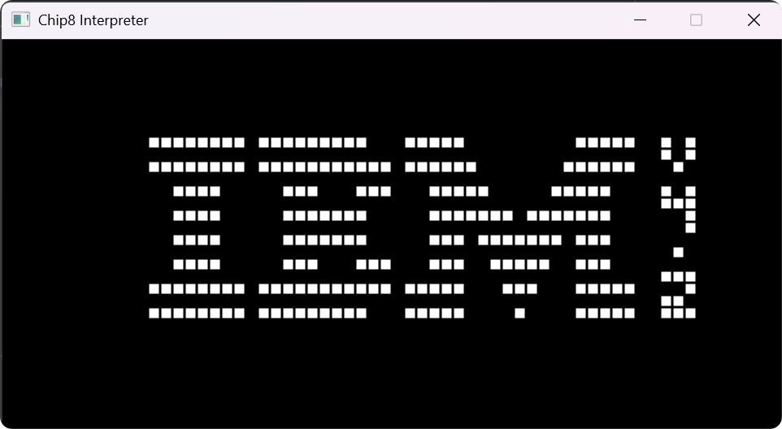

chip8-cpp is my first step into writing an emulator. It implements the CHIP-8 instruction set and uses SDL2 for the display, input handling and sound.

## Running a ROM

The application accepts a CHIP-8 ROM path. The repository documents a CMake build with a C++23 compiler:

```sh
cmake -S . -B build
cmake --build build
```

Run the resulting `chip8cpp-app` executable with the path to a ROM. Its location depends on the build generator and configuration.

## Scope and source

This is a small learning project focused on CHIP-8. It is separate from my handheld adaptations of existing emulators, such as [WQX on GameShell](/projects/wqx-gameshell/) and [Mini vMac on PocketCHIP](/projects/pocketchip-macos/).

The screenshot is the repository's [IBM logo showcase](https://github.com/zzxzzk115/chip8-cpp/blob/master/media/ibm_logo_showcase.png). Source code and build instructions are available in the [MIT-licensed repository](https://github.com/zzxzzk115/chip8-cpp).
