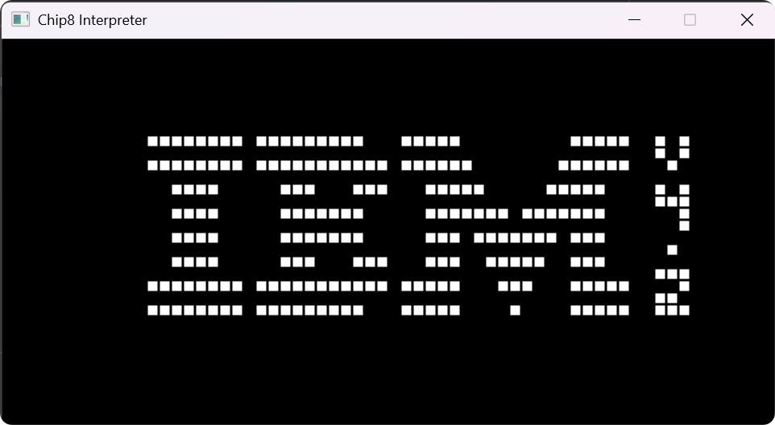

chip8-cpp 是我写模拟器的第一步。它实现了 CHIP-8 指令集，画面显示、输入处理和声音都交给 SDL2。

## 运行 ROM

程序接收一个 CHIP-8 ROM 的路径。仓库里写的构建方式是 CMake，加上支持 C++23 的编译器：

```sh
cmake -S . -B build
cmake --build build
```

编出来的可执行文件叫 `chip8cpp-app`，运行时把 ROM 路径传给它就行。它具体在哪个目录，取决于用的构建生成器和配置。

## 范围与源码

这是一个只关注 CHIP-8 的学习小项目，和我把现有模拟器移植到掌机上的那些项目不是一回事，比如 [GameShell 上的 WQX](/projects/wqx-gameshell/) 和 [PocketCHIP 上的 Mini vMac](/projects/pocketchip-macos/)。

截图是仓库里的 [IBM logo 展示图](https://github.com/zzxzzk115/chip8-cpp/blob/master/media/ibm_logo_showcase.png)。源码和构建说明都在 [MIT 协议的仓库](https://github.com/zzxzzk115/chip8-cpp) 里。
