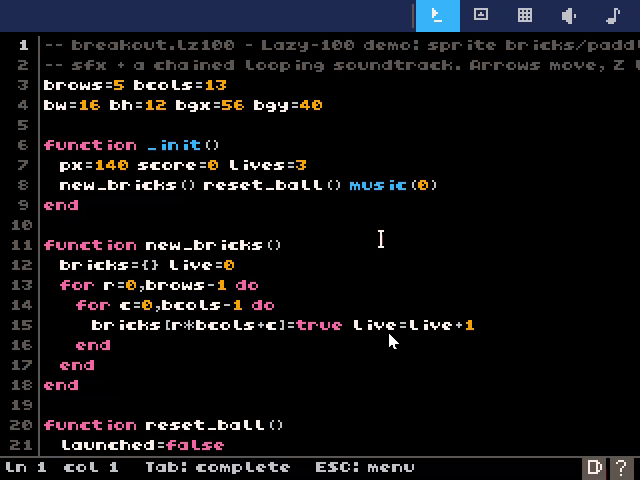

## Try it in your browser

[Play Breakout](https://zzxzzk115.github.io/Lazy-100/?cart=breakout) to jump straight into a cartridge, or [browse the catalog](https://zzxzzk115.github.io/Lazy-100/carts/) to choose Breakout, Lazy Bird or Snake. The console runs in the page; no download or installation is required.

The [console homepage](https://zzxzzk115.github.io/Lazy-100/) also exposes cartridge selection. The same application contains the shell and code, sprite, map, sound and music editors, so the playable games are examples of the console's own creation tools.

## Why This Exists

Two reasons. First, the serious one: Lazy-100 exercises [VRI](/projects/vri/) in a full application, bringing rendering, input, audio, editors and web deployment together. Second, the honest one: I have always loved retro games, and building a fantasy console in the spirit of PICO-8 / TIC-80 / BASIC8 is its own reward.

(The name? **Lazy_V** is my online handle; **100** just sounds nice.)

## What It Is

- A **320×240** indexed-color screen with a 256-color palette, 16×16 sprites, and 4-channel audio.
- A complete **in-console editor suite**: shell, code, sprite, map, sfx, and music editors — you make games _inside_ the console.
- Scripting in **Lua 5.4** (via sol2), with a bold twist: a **dual-VM architecture** that routes PICO-8 carts to a vendored z8lua VM, so supported PICO-8 cartridges execute in a separate PICO-8-compatible VM. Compatibility varies by cartridge.
- Carts are `.lz100` text files or shareable **`.lz100.png`** images with the cart embedded in the picture.
- Built on [VRI](/projects/vultra_ecosystem/#vri) for rendering, SDL3, and miniaudio; runs on desktop and in the browser.

## Looking Ahead

Editor polish and more advanced creative tools are on the wishlist — including [strudel](https://strudel.cc/)-style live-coded music making. A companion catalog repo, [Lazy-100-games](https://github.com/zzxzzk115/Lazy-100-games), collects carts.
