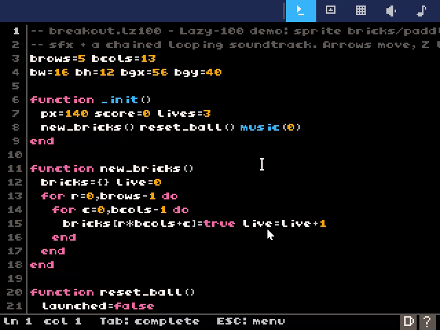

## 在浏览器里试试

[玩打砖块](https://zzxzzk115.github.io/Lazy-100/?cart=breakout) 可以直接进入一张卡带，也可以 [浏览卡带目录](https://zzxzzk115.github.io/Lazy-100/carts/)，从 Breakout、Lazy Bird 和 Snake 里挑一个。主机就跑在网页里，不用下载也不用安装。

[主机首页](https://zzxzzk115.github.io/Lazy-100/) 也能选卡带。同一个程序里就有 shell 和代码、精灵、地图、音效、音乐编辑器，所以这些能玩的游戏，本身也是主机自带创作工具的示例。

## 为什么做它

两个原因。先说正经的：Lazy-100 让 [VRI](/projects/vri/) 在一个完整的应用里接受检验，渲染、输入、音频、编辑器和网页部署全都凑到了一起。再说实话：我一直很喜欢复古游戏，照着 PICO-8 / TIC-80 / BASIC8 的路子做一台幻想主机，这件事本身就很开心。

（名字怎么来的？**Lazy_V** 是我的网名，**100** 只是听着顺耳。）

## 它是什么

- **320×240** 的索引色屏幕，256 色调色板，16×16 的精灵，4 声道音频。
- 一整套 **主机内的编辑器**：shell、代码、精灵、地图、音效和音乐编辑器，游戏就在主机 _里面_ 做。
- 用 **Lua 5.4** 写脚本（通过 sol2），还有个大胆的设计：**双 VM 架构**，把 PICO-8 卡带交给内置的 z8lua VM，这样支持的 PICO-8 卡带会在一个独立的、兼容 PICO-8 的 VM 里运行。兼容程度因卡带而异。
- 卡带可以是 `.lz100` 文本文件，也可以是方便分享的 **`.lz100.png`** 图片，卡带内容就嵌在图片里。
- 渲染基于 [VRI](/projects/vultra_ecosystem/#vri)，再加上 SDL3 和 miniaudio；桌面和浏览器都能跑。

## 接下来

打磨编辑器、加更高级的创作工具都在愿望清单上，其中包括 [strudel](https://strudel.cc/) 那样边写代码边做音乐的玩法。另外还有一个配套的目录仓库 [Lazy-100-games](https://github.com/zzxzzk115/Lazy-100-games)，用来收集卡带。
