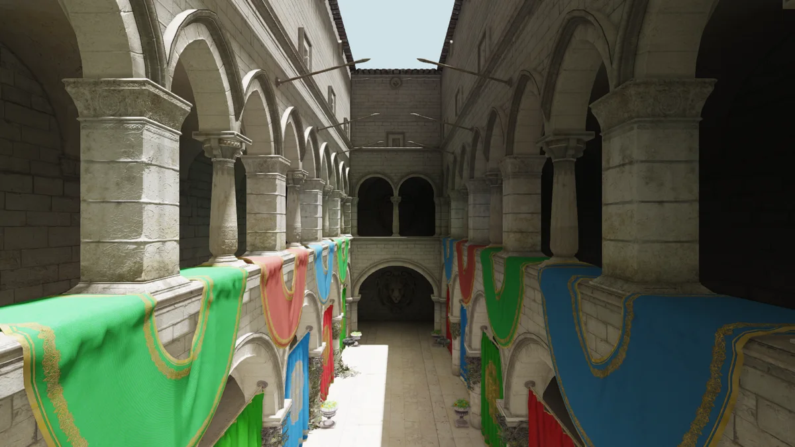

This renderer was developed for my MSc dissertation. It implements Light Propagation Volumes (LPV) for real-time global illumination on top of [VGFW](/projects/vgfw/).

[Read the MSc dissertation (PDF)](/assets/pdf/LPV-MSc-Dissertation.pdf) for the implementation, rendering results and performance evaluation.

The rendering pipeline also includes cascaded shadow maps, horizon-based ambient occlusion, screen-space reflections, FXAA, an ACES filmic tone-mapping approximation and bloom. The repository contains the implementation and additional views of the LPV contribution.

The tone-mapping shader uses the fitted curve described by [Krzysztof Narkowicz](https://knarkowicz.wordpress.com/2016/01/06/aces-filmic-tone-mapping-curve/). This is an approximation, rather than a complete ACES colour-management pipeline.

The project credits [VGFW](https://github.com/zzxzzk115/vgfw), [FrameGraph-Example](https://github.com/skaarj1989/FrameGraph-Example), and the LPV implementation notes linked in its README.
