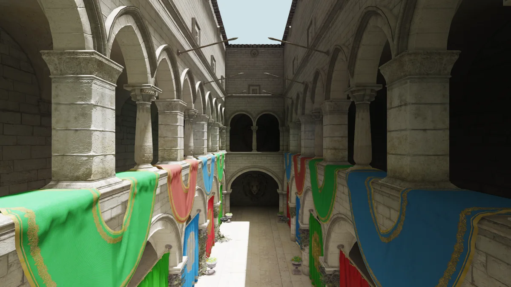

这个渲染器是我的硕士毕业设计。它在 [VGFW](/projects/vgfw/) 的基础上实现了 Light Propagation Volumes（LPV，光传播体积），用来做实时全局光照。

实现细节、渲染效果和性能评估都写在 [硕士毕业论文（PDF）](/assets/pdf/LPV-MSc-Dissertation.pdf) 里。

渲染管线里还有级联阴影贴图、基于地平线的环境光遮蔽（horizon-based AO）、屏幕空间反射、FXAA、近似的 ACES 电影感色调映射，以及 bloom。仓库里有完整的实现，还有更多展示 LPV 效果的画面。

色调映射的 shader 用的是 [Krzysztof Narkowicz](https://knarkowicz.wordpress.com/2016/01/06/aces-filmic-tone-mapping-curve/) 给出的拟合曲线。这只是一个近似，不是完整的 ACES 色彩管理管线。

项目致谢了 [VGFW](https://github.com/zzxzzk115/vgfw)、[FrameGraph-Example](https://github.com/skaarj1989/FrameGraph-Example)，以及 README 里链接的那些 LPV 实现笔记。
