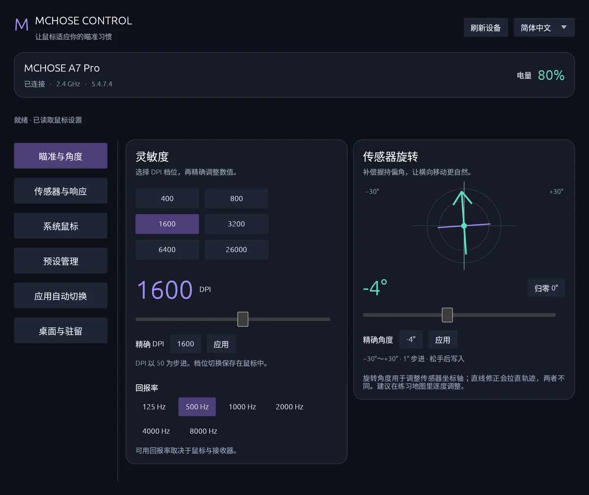

This Linux desktop tool configures MCHOSE mouse DPI, polling rate, sensor rotation and other hardware settings. It includes a GUI, a CLI, editable presets and automatic switching based on the foreground application.

Desktop integration covers tray operation, single-instance activation and KDE mouse settings. The interface supports Chinese and English.

This is an independent derivative of [Alexandre Frih's mchose-linux](https://github.com/alexfrih/mchose-linux), retaining its HID protocol implementation and extending the interface and desktop integration. It is not official MCHOSE software.
