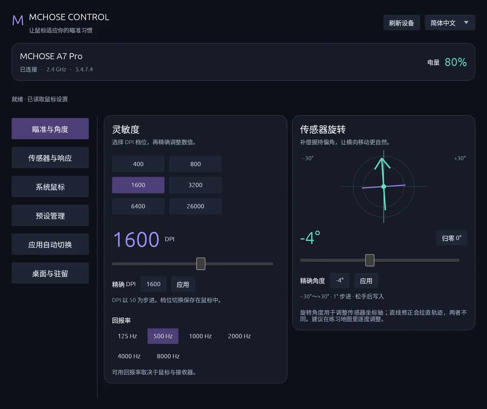

这是一个 Linux 桌面工具，用来设置 MCHOSE 鼠标的 DPI、回报率、传感器旋转角度等硬件参数。它有 GUI 也有 CLI，预设可以自己编辑，还能根据前台应用自动切换。

桌面集成方面，支持托盘运行、单实例激活，也接入了 KDE 的鼠标设置。界面支持中文和英文。

它是 [Alexandre Frih 的 mchose-linux](https://github.com/alexfrih/mchose-linux) 的独立衍生项目：保留了原项目的 HID 协议实现，在界面和桌面集成上做了扩展。这不是 MCHOSE 官方软件。
