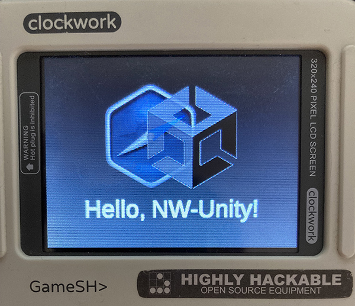

NW-Unity packages an existing Unity WebGL output folder into an NW.js application folder. It is part of my earlier work bringing games and software to GameShell.

## Packaging workflow

The `nwunity` CLI accepts the WebGL export directory and application name, along with options for window size, fullscreen mode, resizing, icons and platform selection. A dedicated GameShell mode handles that target's packaging workflow.

The [repository README](https://github.com/zzxzzk115/NW-Unity#quick-usage) documents installation and example commands. Its Unity, NW.js and GameShell setup notes reflect the versions used for this earlier project.

## Handheld demonstration

The cover is the repository's [GameShell sample photograph](https://github.com/zzxzzk115/NW-Unity/blob/master/images/run_on_gameshell.JPG). The repository also includes a Windows sample capture and GameShell-specific setup notes.
