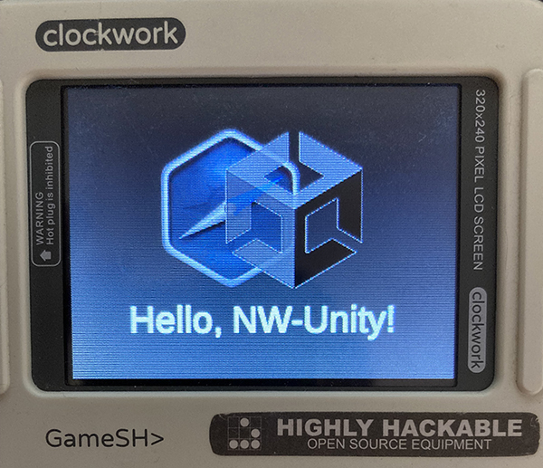

NW-Unity 把现成的 Unity WebGL 导出目录打包成一个 NW.js 应用目录。它是我早年把游戏和软件搬到 GameShell 上的工作之一。

## 打包流程

`nwunity` 命令行接收 WebGL 导出目录和应用名，还能设置窗口大小、全屏、是否允许调整窗口大小、图标和目标平台。另外有一个专门的 GameShell 模式，负责这个平台的打包流程。

安装方法和示例命令见 [仓库 README](https://github.com/zzxzzk115/NW-Unity#quick-usage)。里面 Unity、NW.js 和 GameShell 的配置说明，对应的是当年做这个项目时用的版本。

## 掌机演示

封面是仓库里的 [GameShell 示例照片](https://github.com/zzxzzk115/NW-Unity/blob/master/images/run_on_gameshell.JPG)。仓库里还有一张 Windows 上的示例截图，以及 GameShell 专用的配置说明。
