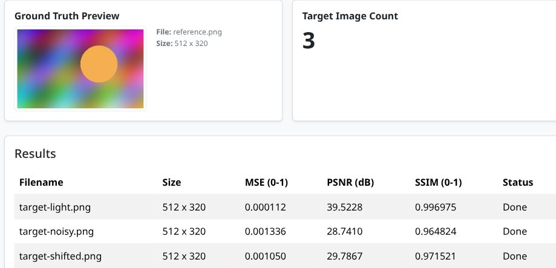

A small collection of browser-based image comparison tools written in HTML, CSS and JavaScript.

The image metrics tool compares one reference image with multiple target images using the structural similarity index (SSIM), peak signal-to-noise ratio (PSNR) and mean squared error (MSE). A second tool generates absolute error maps and heatmaps, using Plotly for visualization.

The interface supports English and Chinese. These tools are useful for inspecting rendering outputs alongside the experiments that produced them.
