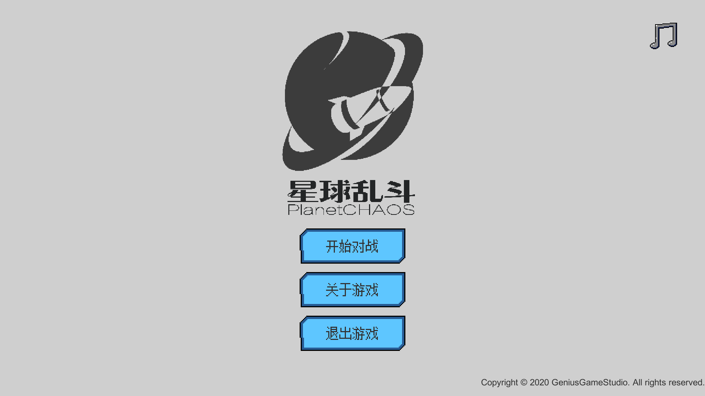
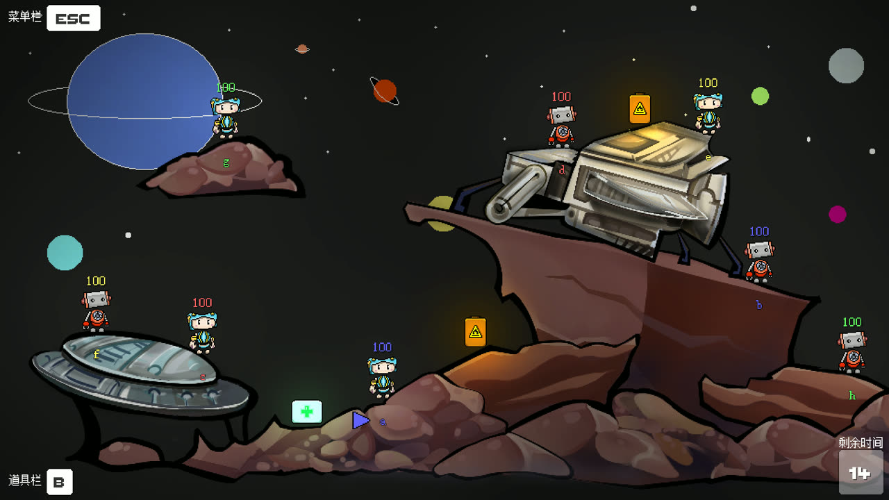
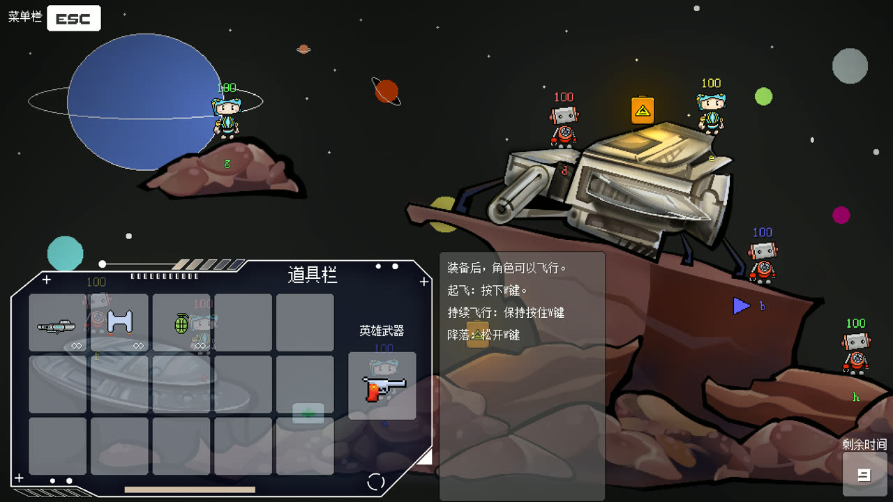
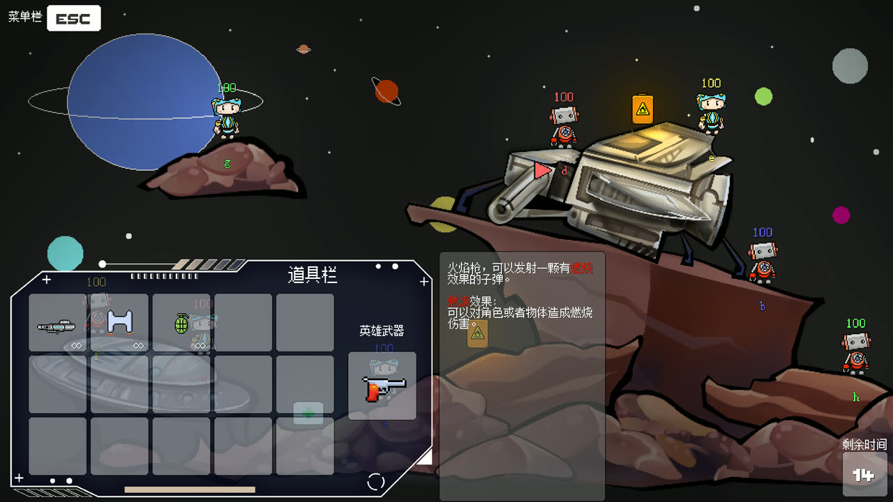

Planet Chaos 2 is the sequel to [Planet Chaos](/projects/planet-chaos/), made with the same friends at GeniusGameStudio. It moved to pixel art and Unity URP, and added more weapons and gameplay systems.

Builds are on the [GitHub releases page](https://github.com/GeniusGameStudio/PlanetChaos2/releases).
