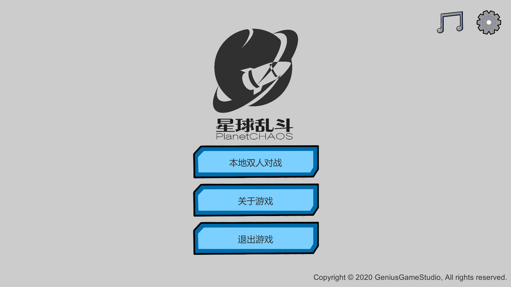
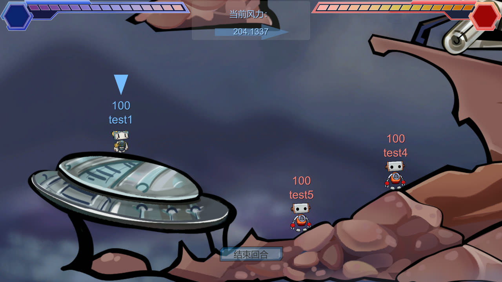
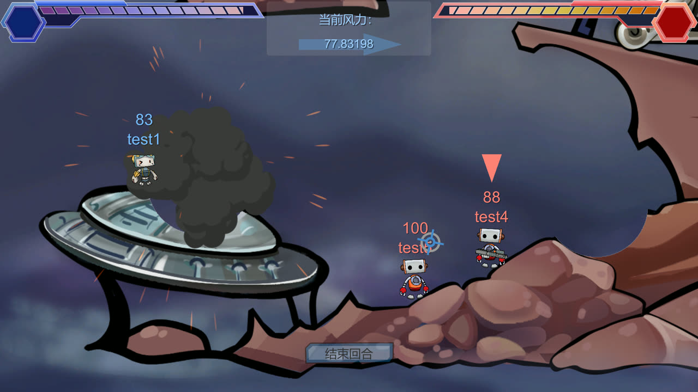
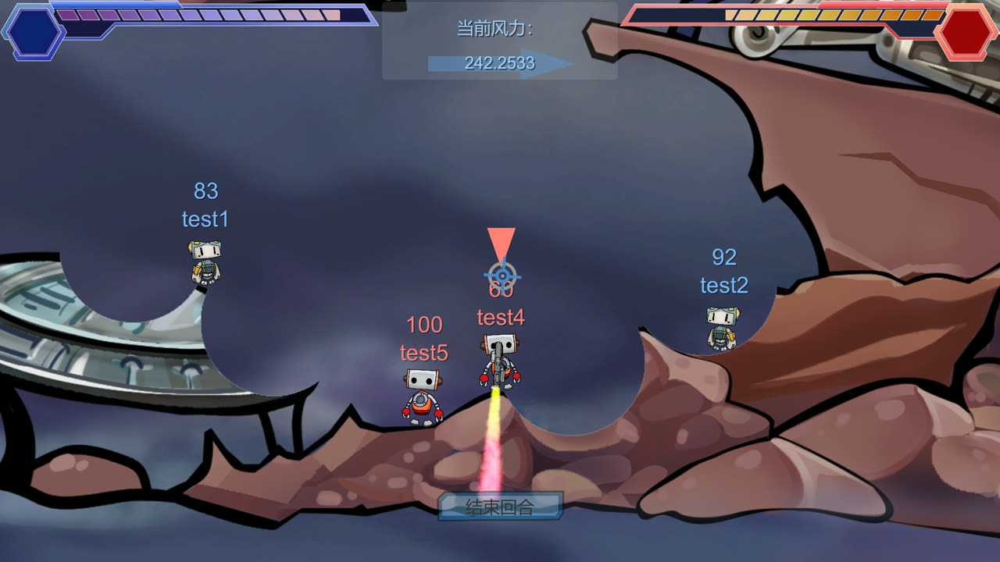

Planet Chaos is a team game I made with friends at GeniusGameStudio in 2020: Worms-style multiplayer 2D artillery battles, built in Unity 2019.4 LTS. I worked on the core architecture and the gameplay code, and coordinated the schedule.

The sequel, [Planet Chaos 2](/projects/planet-chaos-2/), moved to pixel art and Unity URP.

Builds are on the [GitHub releases page](https://github.com/GeniusGameStudio/PlanetChaos/releases).
