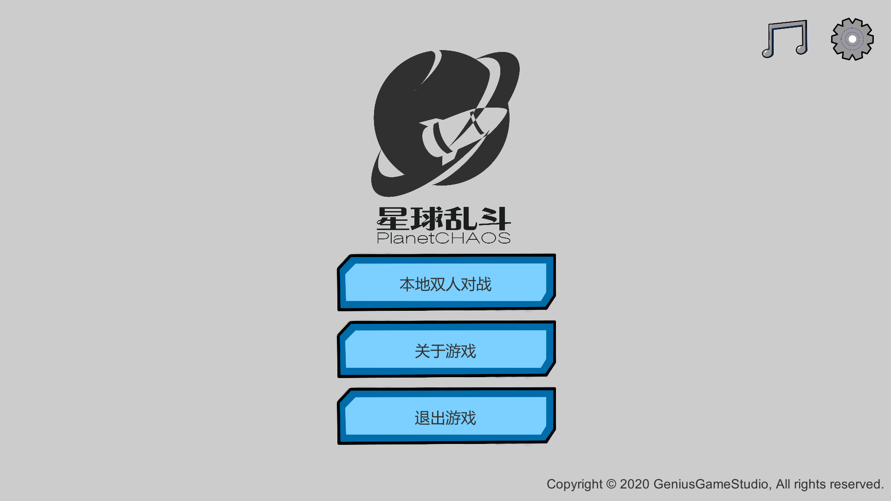
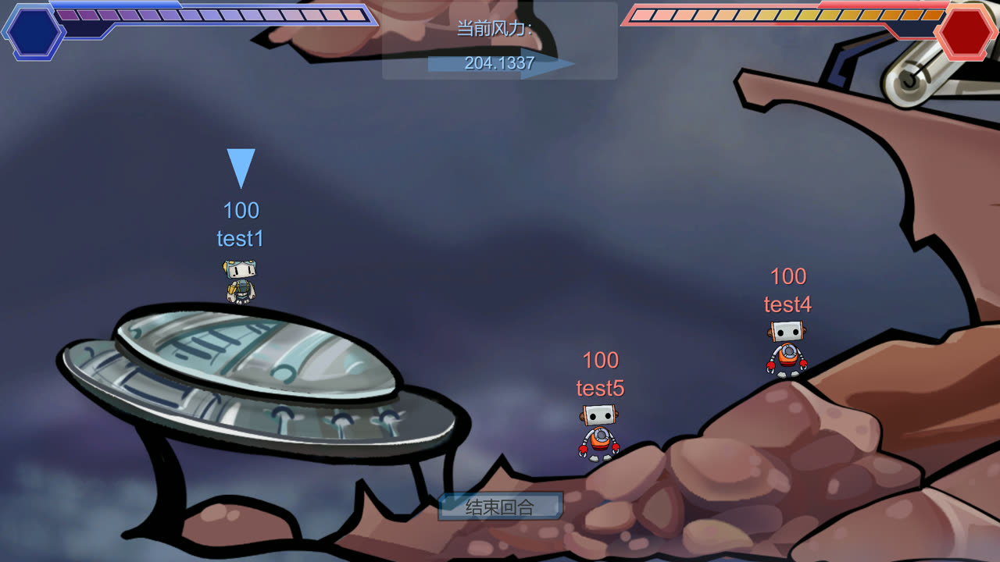
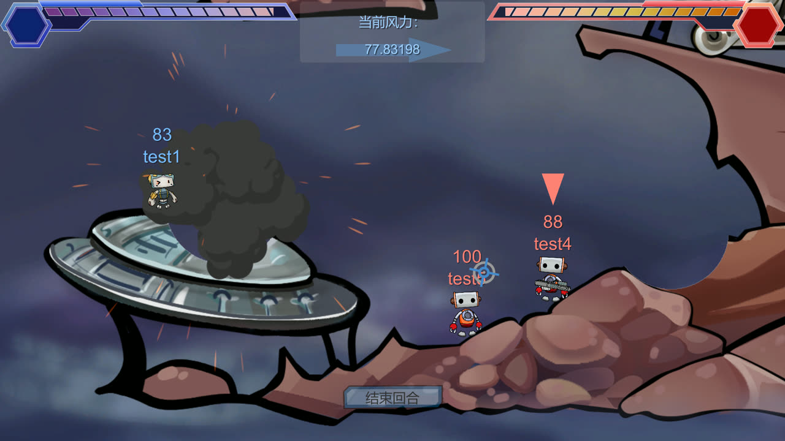
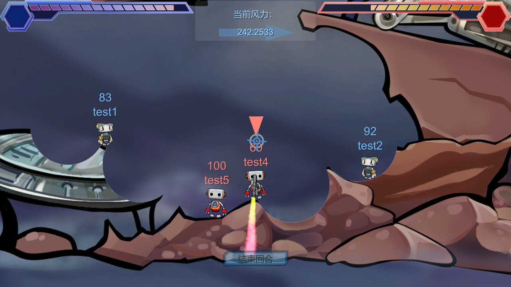

Planet Chaos 是 2020 年我和 GeniusGameStudio 的伙伴们一起做的团队游戏：类似《百战天虫》的多人 2D 炮击对战，用 Unity 2019.4 LTS 开发。核心架构和玩法程序是我写的，开发进度也由我来协调。

续作 [Planet Chaos 2](/projects/planet-chaos-2/) 换成了像素美术和 Unity URP。

安装包在 [GitHub Releases 页面](https://github.com/GeniusGameStudio/PlanetChaos/releases)。
