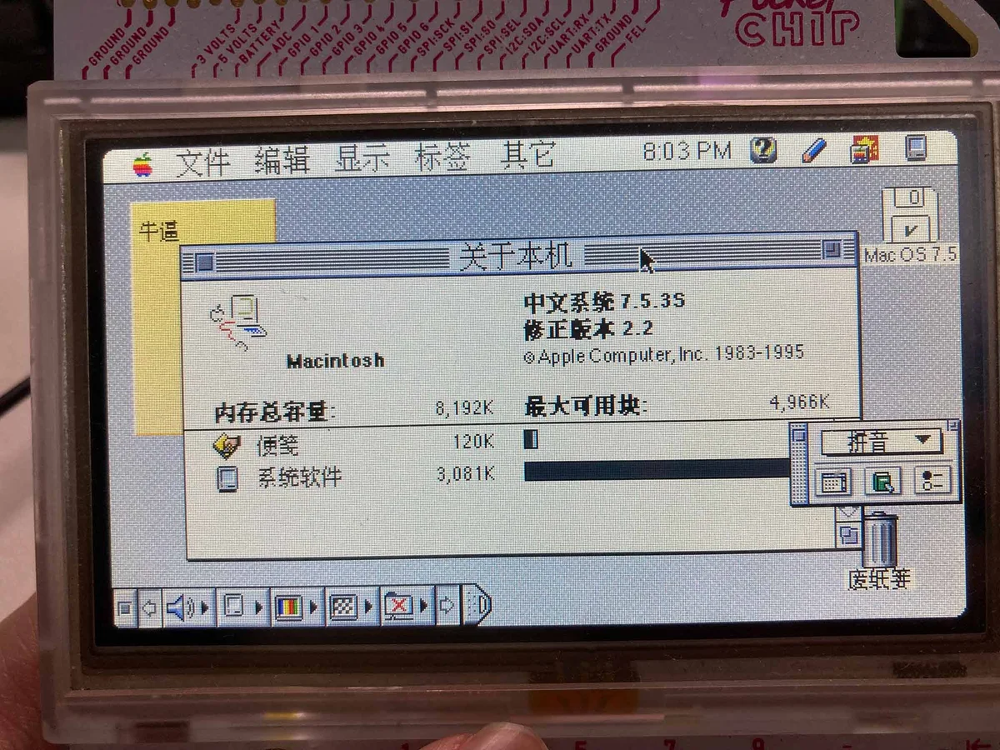

This project runs classic Mac OS System 7.5 on PocketCHIP using a custom Mini vMac build. The repository provides the handheld executable and usage instructions for a user-supplied disk image.

My work here is the PocketCHIP adaptation and build. Mini vMac is the underlying emulator; this project does not claim authorship of the emulator or Mac OS.
