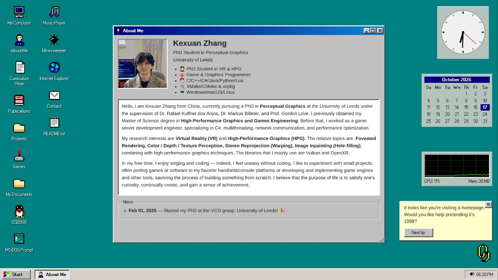

Portfolio-98 是我作品集的另一种好玩的打开方式，用 Next.js 写的。在电脑上，它是一个可以拖动、缩放窗口的桌面，有任务栏和开始菜单；到了手机上，就换成 Pocket PC / PDA 风格的外壳，应用全屏打开。

## 把作品集做成桌面

简历、项目、论文和文章都来自 Markdown 文件，再由一个应用注册表把它们接到桌面窗口和手机端的启动器上。其他应用还有虚拟文件系统、MS-DOS 风格的命令行、扫雷和音乐播放器。[Lazy-100](/projects/lazy_100/) 就跑在一个游戏窗口里。

## 界面与致谢

界面里有可配置的壁纸、屏保、GLSL 背景，还有一些致敬那个年代的小彩蛋。封面截自 [在线演示](https://zzxzzk115.github.io/portfolio-98/)。

控件样式用的是 98.css，现场编码的音乐用的是 Strudel。源码和致谢都在 [AGPL-3.0 仓库](https://github.com/zzxzzk115/portfolio-98) 里。
