vasset is a library and command-line pipeline for importing and packaging engine assets. It uses VMesh, VTexture and VMaterial formats, tracks assets by UUID, and packs them into VPK archives that can be mounted through [vfilesystem](https://github.com/zzxzzk115/vfilesystem).

Desktop builds provide import and packing tools. Android distributions focus on the runtime libraries. WebAssembly builds can include the importer, with a browser upload example in the repository.

```sh
vasset-cli import <asset-root>
vasset-cli pack <asset-root> <out.vpk>
```

The [release documentation](https://github.com/zzxzzk115/vasset#prebuilt-releases) distinguishes the available tools and runtime bundles.
