vasset 是一个用来导入和打包引擎资源的库，外加一套命令行管线。它用 VMesh、VTexture 和 VMaterial 这几种格式，按 UUID 追踪资源，最后打包成 VPK 归档，可以通过 [vfilesystem](https://github.com/zzxzzk115/vfilesystem) 挂载。

桌面版提供导入和打包工具；Android 发行版主要是运行时库；WebAssembly 版可以带上导入器，仓库里还有一个在浏览器里上传资源的示例。

```sh
vasset-cli import <asset-root>
vasset-cli pack <asset-root> <out.vpk>
```

哪些发行包里有哪些工具、哪些是运行时包，[发布说明文档](https://github.com/zzxzzk115/vasset#prebuilt-releases) 里都分开写清楚了。
