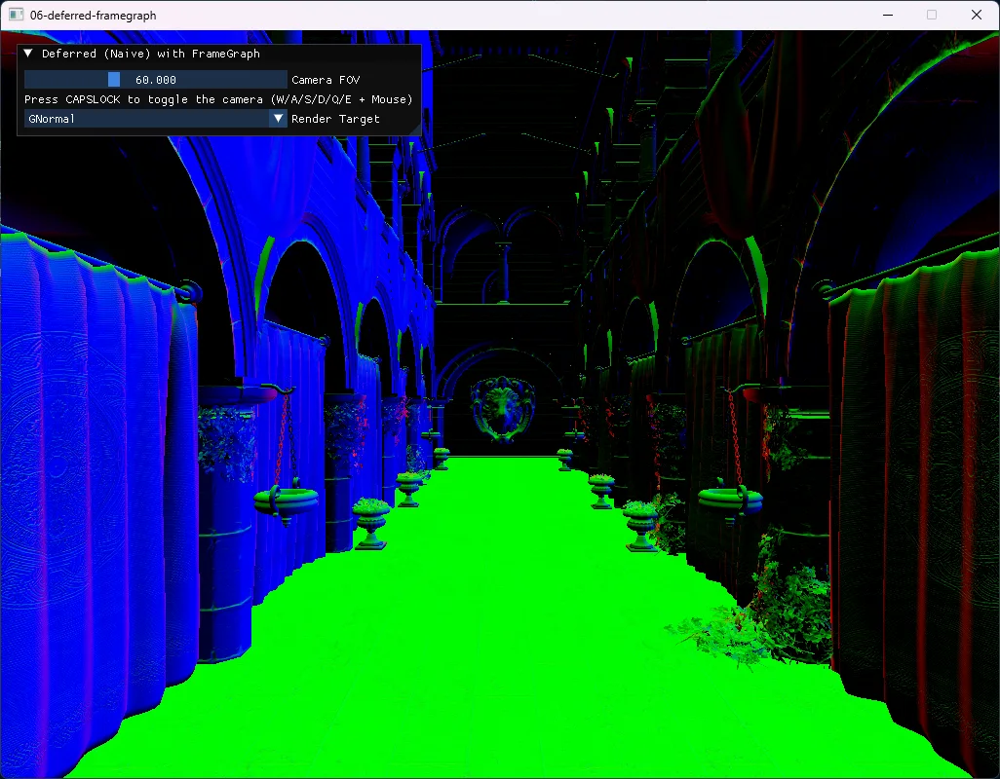

VGFW is a header-only graphics framework for quickly trying rendering ideas. It supports OBJ and glTF models, a framegraph, Dear ImGui integration and Tracy profiling.

The framework requests an OpenGL 4.6 context and can fall back to 3.3. Applications still need shaders compatible with the context they actually obtain; some advanced examples require newer GLSL versions.

I used VGFW as the rendering framework for my [Light Propagation Volumes dissertation project](/projects/light-propagation-volumes/).
