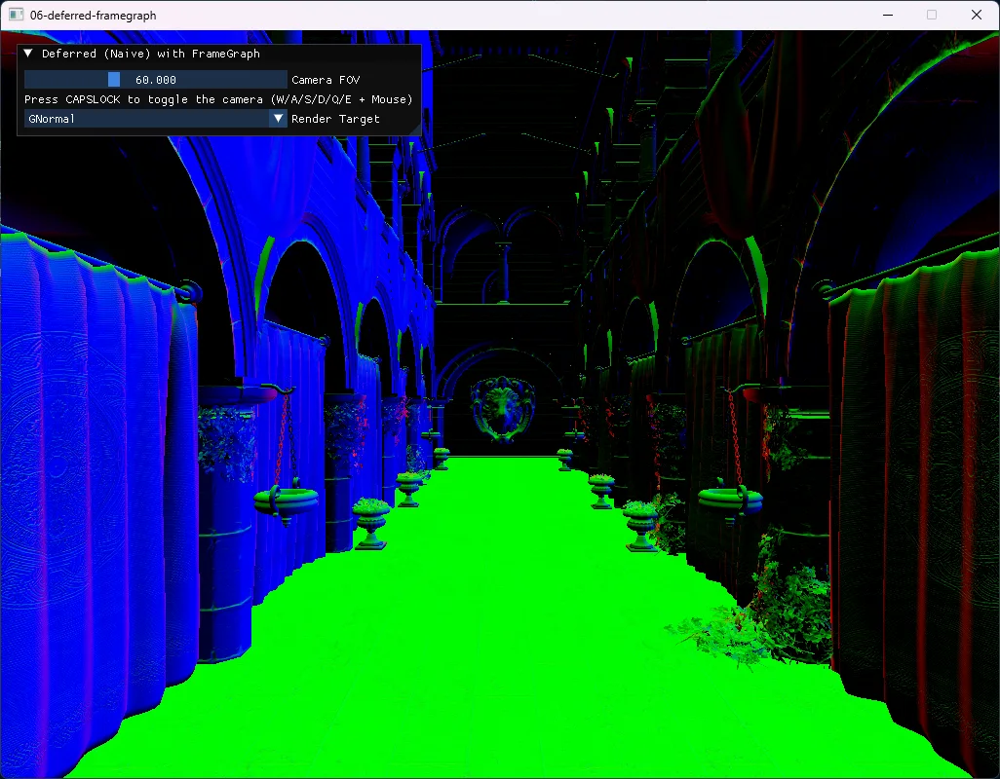

VGFW 是一个 header-only 的图形框架，用来快速试验渲染想法。它支持 OBJ 和 glTF 模型、framegraph、Dear ImGui 集成和 Tracy 性能分析。

框架会请求 OpenGL 4.6 上下文，拿不到时可以回退到 3.3。不过应用里的 shader 还是得和实际拿到的上下文兼容；有些进阶示例需要更新版本的 GLSL。

我在 [Light Propagation Volumes 毕业论文项目](/projects/light-propagation-volumes/) 里用的渲染框架就是 VGFW。
