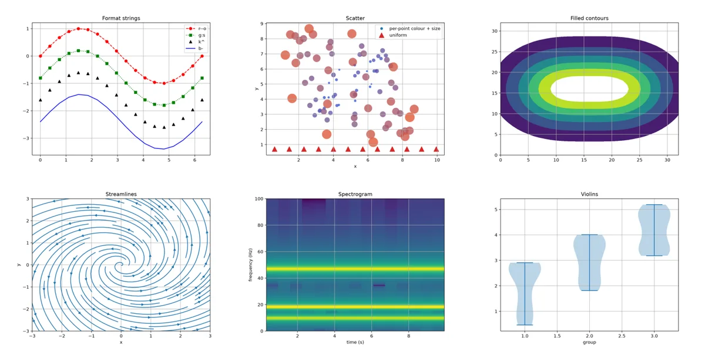

vplot adapts Matplotlib's C++ rendering core into a standalone C++23 library and exposes it through a C ABI. It can export figures for papers or draw plots inside a renderer’s Dear ImGui interface without a Python runtime.

It supports line and scatter plots, histograms, box and violin plots, image and contour plots, vector fields, annotations, axes and subplot layouts. Output includes RGBA buffers, PNG, SVG and PDF.

The API is still evolving and coverage varies by plotting method. The [coverage document](https://github.com/zzxzzk115/vplot/blob/main/docs/API-COVERAGE.md) describes the current limits. The browser demo runs through WebGPU or WebGL 2.
