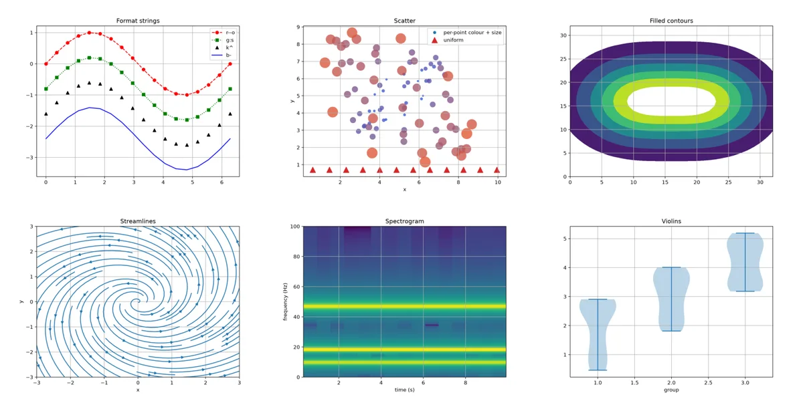

vplot 把 Matplotlib 的 C++ 渲染核心改造成一个独立的 C++23 库，并通过 C ABI 对外提供接口。不需要 Python 运行时，就能导出论文用的图，或者直接在渲染器的 Dear ImGui 界面里画图。

它支持折线图和散点图、直方图、箱线图和小提琴图、图像和等高线图、向量场、标注、坐标轴以及子图布局。输出可以是 RGBA 缓冲区、PNG、SVG 或 PDF。

API 还在变，不同绘图方法的完成度也不一样，目前的限制写在 [覆盖情况文档](https://github.com/zzxzzk115/vplot/blob/main/docs/API-COVERAGE.md) 里。浏览器演示跑在 WebGPU 或 WebGL 2 上。
