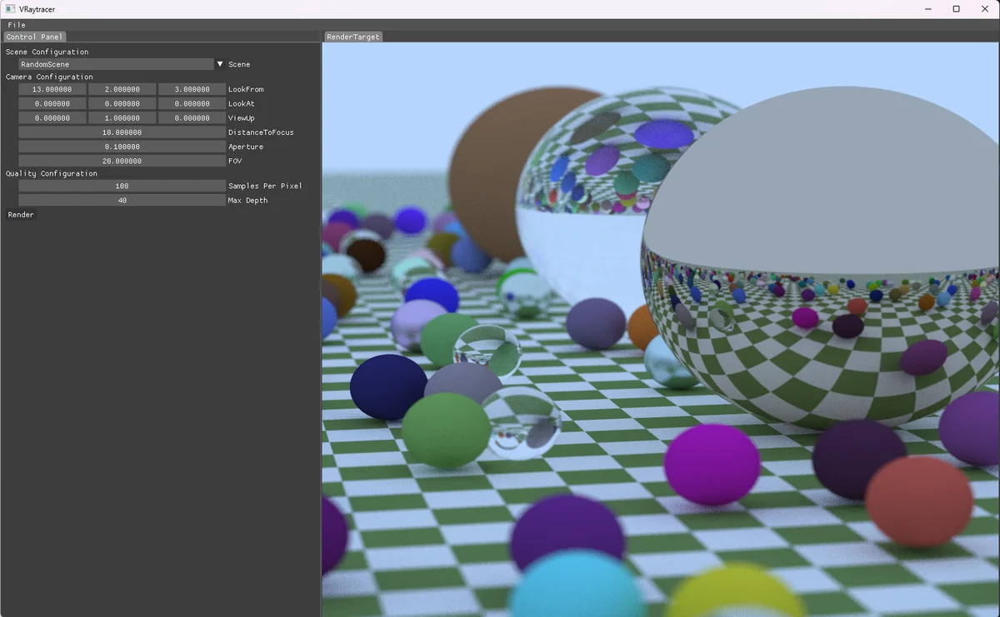

VRaytracer is a C++ ray tracer with an ImGui interface, multithreaded rendering and configurable scenes.

The repository contains CMake build instructions for Windows, Linux and macOS. Physically based materials and Wavefront OBJ loading remain on its roadmap.
