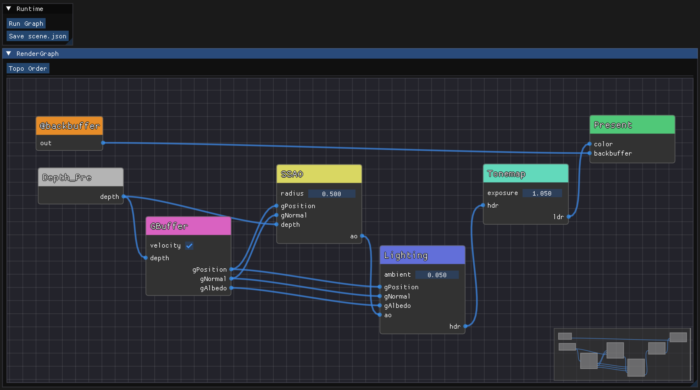

vrendergraph is a small data-driven layer that builds a runtime FrameGraph from JSON. Pass inputs and outputs describe slot connections; the host supplies the pass implementations and interprets engine-specific settings.

## Runtime and editor data

- The runtime builder executes passes in the order of the JSON `passes` array.
- The v0.3 schema adds resource descriptors, conditions, view modes and resource selectors while retaining support for v0.2 descriptions.
- Optional editor metadata stores node positions and other UI state, without affecting runtime execution.

The repository includes [runtime integration](https://github.com/zzxzzk115/vrendergraph/blob/master/docs/RUNTIME.md) and [editor integration](https://github.com/zzxzzk115/vrendergraph/blob/master/docs/EDITOR.md) guides.

## Place in the Vultra ecosystem

This standalone library belongs to the [Vultra ecosystem](/projects/vultra_ecosystem/). It was used in earlier data-driven pipeline experiments. Current libvultra `dev-VRI` documents its own RenderGraph interfaces and JSON construction separately; this page does not imply that vrendergraph is a dependency of that branch.

The image is the repository's [editor example screenshot](https://github.com/zzxzzk115/vrendergraph/blob/master/media/vrendergraph_editor_example.png).
