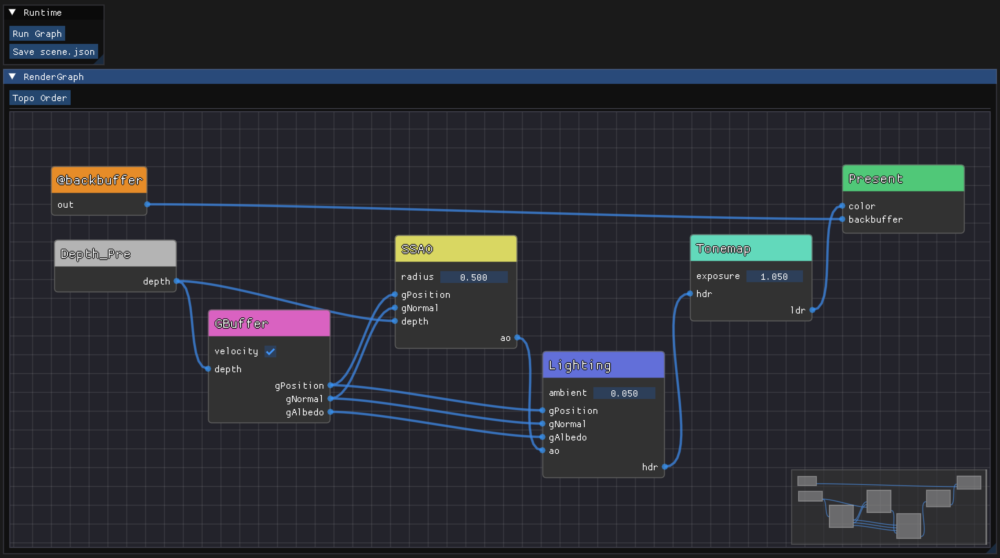

vrendergraph 是一个数据驱动的小模块，用 JSON 在运行时构建 FrameGraph。每个 pass 的输入和输出描述了槽位之间怎么连；pass 的具体实现由宿主程序提供，引擎相关的设置也由宿主自己解释。

## 运行时与编辑器数据

- 运行时构建器按 JSON 里 `passes` 数组的顺序执行 pass。
- v0.3 schema 加入了资源描述符、条件、视图模式和资源选择器，同时仍然兼容 v0.2 的描述。
- 可选的编辑器元数据用来保存节点位置等 UI 状态，不影响运行时执行。

仓库里有 [运行时集成](https://github.com/zzxzzk115/vrendergraph/blob/master/docs/RUNTIME.md) 和 [编辑器集成](https://github.com/zzxzzk115/vrendergraph/blob/master/docs/EDITOR.md) 两份指南。

## 在 Vultra 生态里的位置

这是一个独立的库，属于 [Vultra 生态](/projects/vultra_ecosystem/)，早先在一些数据驱动管线的实验里用过。现在 libvultra 的 `dev-VRI` 有自己的 RenderGraph 接口和 JSON 构建方式，文档是另外写的；这里并不是说那个分支依赖 vrendergraph。

图片是仓库里的 [编辑器示例截图](https://github.com/zzxzzk115/vrendergraph/blob/master/media/vrendergraph_editor_example.png)。
