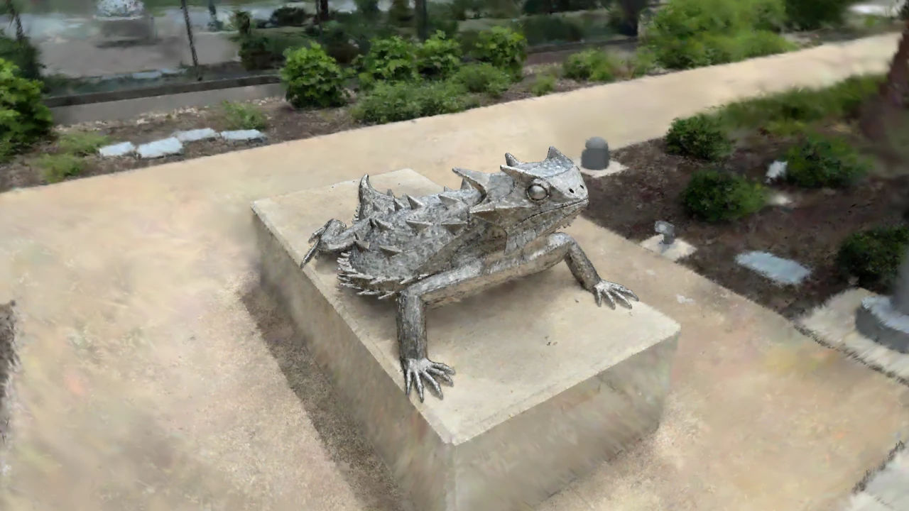

VRI-Framework is a public library of rendering capabilities built over [VRI](/projects/vri/). It provides resource ownership, device and presentation helpers, framegraph construction, descriptor management, GPU profiling and OpenXR lifecycle support.

It is a toolkit for composing a renderer. Applications supply their own passes, scenes and shaders. The library includes an application loop for examples and a render module for host-driven integration.

It belongs to the [Vultra ecosystem](/projects/vultra_ecosystem/), but it is a separate project. The current libvultra `dev-VRI` branch uses VRI directly; this framework is not a mandatory layer between VRI and libvultra.
