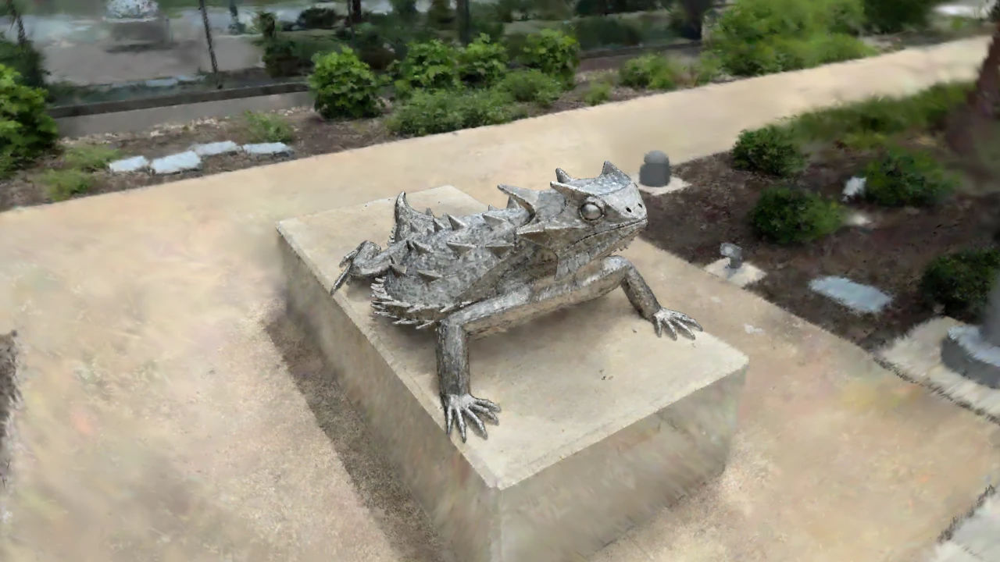

VRI-Framework 是一个公开的渲染能力库，基于 [VRI](/projects/vri/)。它提供资源所有权管理、设备和 presentation 辅助、FrameGraph 构建、descriptor 管理、GPU 性能分析，以及 OpenXR 生命周期支持。

它是一套用来拼装渲染器的工具箱：pass、场景和 shader 都由应用自己提供。库里有一个给示例用的应用循环，还有一个渲染模块，方便由宿主程序驱动来集成。

它属于 [Vultra 生态](/projects/vultra_ecosystem/)，但是一个独立的项目。当前 libvultra 的 `dev-VRI` 分支直接用 VRI，这个框架并不是夹在 VRI 和 libvultra 之间、非用不可的一层。
