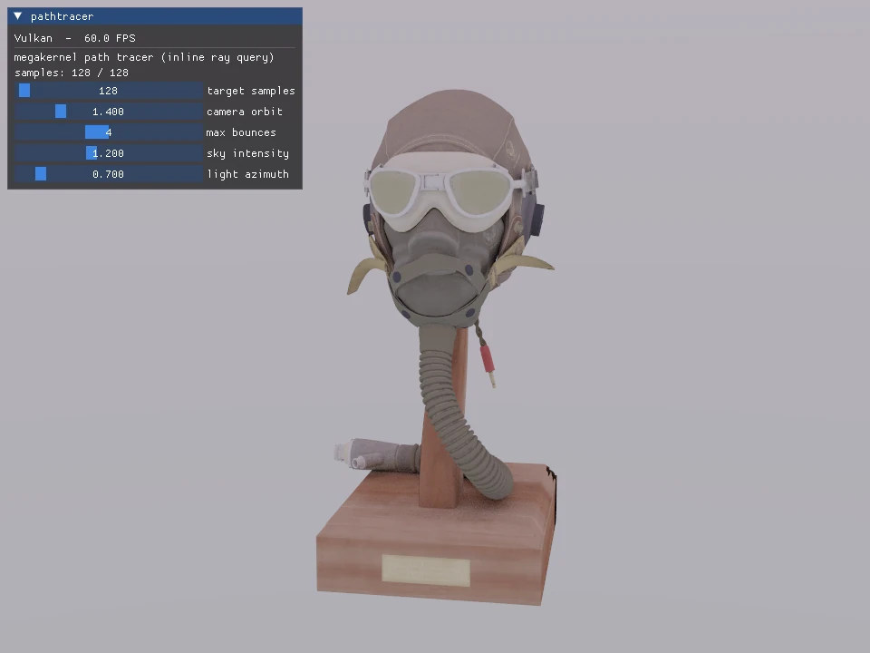

## Try it in your browser

Start with the [WebGPU path tracer](https://zzxzzk115.github.io/VRI/examples/example-pathtracer.html?backend=webgpu): it loads the FlightHelmet glTF model and progressively accumulates samples. Adjust the camera orbit, sample target, bounce count and lighting to see the renderer respond. On WebGPU, traversal uses a software BVH in compute shaders.

The [example gallery](https://zzxzzk115.github.io/VRI/examples/) offers separate WebGPU and WebGL 2 launch buttons. For a lighter WebGL 2 example, try the [textured cube](https://zzxzzk115.github.io/VRI/examples/example-cube.html?backend=webgl). Optional capabilities vary by backend: the WebGL 2 path-tracer entry runs a reduced fallback, rather than the WebGPU path-tracing implementation. The cover image above was rendered with the native Vulkan backend.

## What I built

VRI provides an explicit rendering API with command buffers, descriptor sets and synchronization. Applications can query optional capabilities and receive diagnostics from VRI and the native backend.

The C ABI is paired with a header-only C++23 wrapper. Shaders are authored in Slang and compiled for each target. Backends cover Vulkan, Direct3D 12, Metal, WebGPU, OpenGL, OpenGL ES and WebGL 2; feature availability varies by backend. Software Vulkan implementations can also run the Vulkan path without a hardware GPU.

[Lazy-100](/projects/lazy_100/) uses VRI. [VRI-Framework](/projects/vri-framework/) supplies reusable higher-level rendering capabilities, while the current [libvultra development branch](/projects/vultra_ecosystem/#libvultra) builds directly on VRI.

The repository's [capability matrix](https://github.com/zzxzzk115/VRI#feature-support) records native, emulated, planned and unavailable features.
