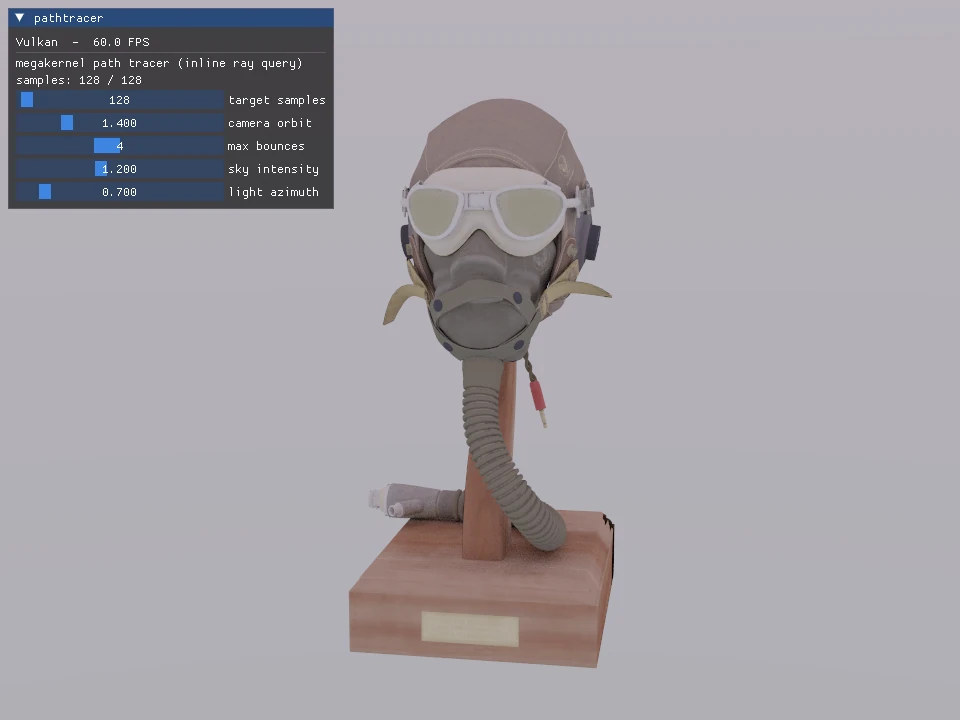

## 在浏览器里试试

可以先打开 [WebGPU 路径追踪器](https://zzxzzk115.github.io/VRI/examples/example-pathtracer.html?backend=webgpu)：它会加载 FlightHelmet glTF 模型，然后一帧帧累积采样。你可以调相机环绕、目标采样数、弹射次数和光照，看渲染结果怎么变化。在 WebGPU 上，求交遍历用的是跑在 compute shader 里的软件 BVH。

[示例页面](https://zzxzzk115.github.io/VRI/examples/) 里，WebGPU 和 WebGL 2 各有单独的启动按钮。想看个轻量点的 WebGL 2 示例，可以试试 [贴图立方体](https://zzxzzk115.github.io/VRI/examples/example-cube.html?backend=webgl)。可选功能因后端而异：WebGL 2 下的路径追踪入口跑的是一个简化的 fallback 版本，不是 WebGPU 那套路径追踪实现。上面的封面图是用原生 Vulkan 后端渲染的。

## 我做了什么

VRI 提供一套显式的渲染 API，有 command buffer、descriptor set 和同步机制。应用可以查询可选的 capability，也能收到来自 VRI 和底层原生后端的诊断信息。

C ABI 之外还配了一层 header-only 的 C++23 封装。shader 用 Slang 写，再针对每个目标分别编译。后端包括 Vulkan、Direct3D 12、Metal、WebGPU、OpenGL、OpenGL ES 和 WebGL 2，各后端能用的功能不完全一样。用软件实现的 Vulkan，在没有硬件 GPU 的机器上也能跑 Vulkan 这条路径。

[Lazy-100](/projects/lazy_100/) 用的就是 VRI。[VRI-Framework](/projects/vri-framework/) 在它上面提供更高层、可复用的渲染能力；而当前的 [libvultra 开发分支](/projects/vultra_ecosystem/#libvultra) 则是直接基于 VRI 搭的。

仓库里的 [capability 矩阵](https://github.com/zzxzzk115/VRI#feature-support) 列出了每个功能是原生支持、模拟实现、计划中还是不可用。
