vshadersystem separates offline shader compilation from runtime loading. Its `vshaderc` compiler processes Slang source, material attributes, reflection and keyword variants; the runtime consumes precompiled libraries without linking Slang.

Version 1.0 replaced the earlier INI-style GLSL language with Slang user-defined attributes. Slang emits SPIR-V and WGSL directly. Outputs include `.vshbin`, `.vshlib` and reusable `.vshslang` source packs.

The desktop compiler prepares assets for desktop, Android and WebAssembly consumers. The [repository documentation](https://github.com/zzxzzk115/vshadersystem#overview) describes the format change and authoring workflow.
