vshadersystem 把离线的 shader 编译和运行时加载拆成了两部分。编译器 `vshaderc` 负责处理 Slang 源码、材质属性、反射和关键字变体；运行时只读取预编译好的库，不需要链接 Slang。

1.0 版用 Slang 的用户自定义属性（user-defined attributes）替换掉了之前那套 INI 风格的 GLSL 语言。Slang 可以直接生成 SPIR-V 和 WGSL。输出有 `.vshbin`、`.vshlib`，以及可复用的 `.vshslang` 源码包。

桌面端的编译器负责为桌面、Android 和 WebAssembly 端准备资源。格式上的变化和编写流程，可以看 [仓库文档](https://github.com/zzxzzk115/vshadersystem#overview)。
