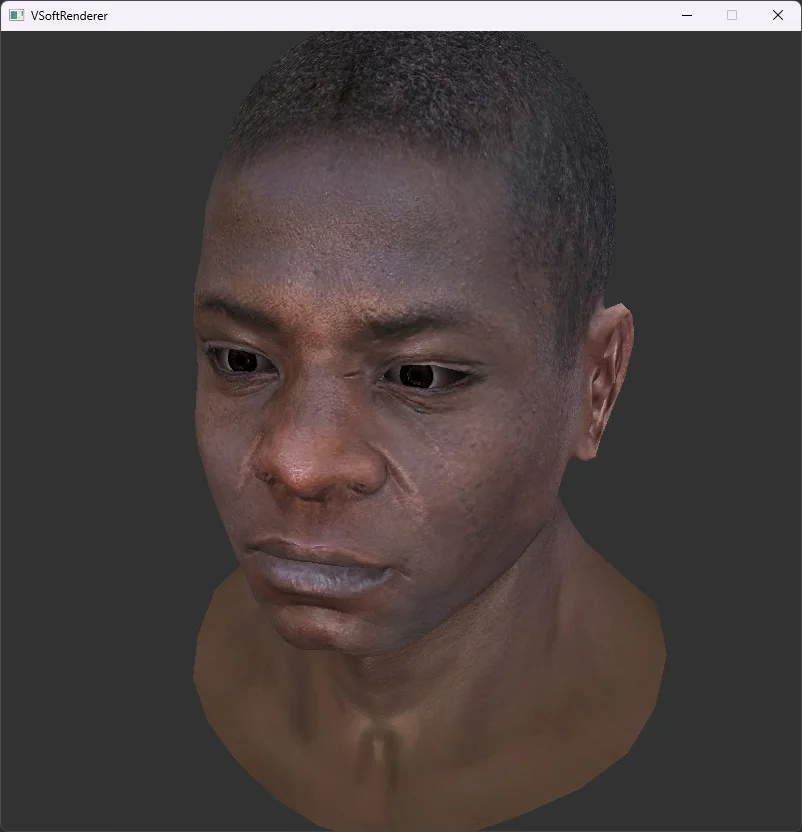

VSoftRenderer is a small software renderer for Windows, Linux and macOS. It exposes a programmable shading pipeline through C++ shader classes.

The examples demonstrate Gouraud shading and Phong shading with diffuse, normal and specular textures. This project records my earlier work on the rendering pipeline before the later graphics frameworks.
