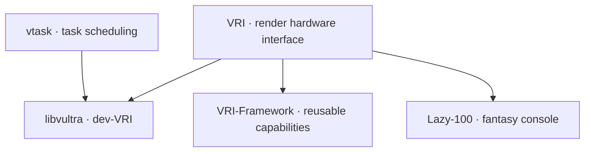
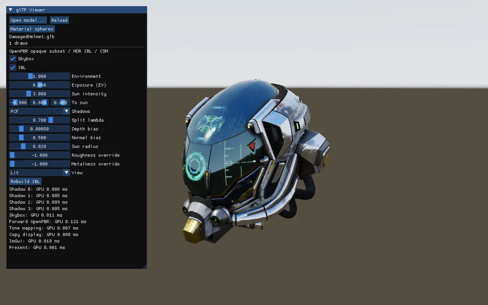

Vultra 是我为科研和游戏开发维护的一组图形与引擎项目。libvultra 现在的开发都在 **`dev-VRI`** 分支上。**`dev-next` 只是一次实验**，那里的原型和当前的开发分支是分开的。

## 起源

这些项目最早来自 [Snow Leopard Engine](/projects/snow_leopard_engine/)，那是我在利兹大学读硕士时做的一个 OpenGL 小组项目；后来读博需要各种渲染工具，就一路做了下来。我把能复用的部分拆成了独立的仓库，这样小程序和科研原型也能直接拿来用。

## 设计原则

- 渲染 API 要显式，C++ / Slang 代码要好读。
- 功能按需取用：一个直接跑 GPU 的小程序，不应该非得带上编辑器、ECS、导入器或脚本宿主。
- 工具和库都能复用，并且各自职责清楚。
- 该离线处理的资源和 shader 就离线处理，同时也保留运行时的查看和实验能力。

## 为什么不用现成的方案？

我想要一套适合自己做图形和 VR 实验的框架：资源和同步能显式控制，shader 能跨平台，支持 OpenXR，还要有一些可以直接读、直接改的小示例。正是这些需求，才有了 VRI 和相关的这些库。

## 架构

当前的 libvultra 分支直接用 VRI。VRI-Framework 是基于同一套 RHI 的另一个可复用库，并不是 libvultra 必须依赖的中间层。

下面的 shader、资源、文件系统和 JSON 渲染图这几个项目，都是整个生态里独立的部分。列在这里，不代表它们都是当前引擎分支的依赖。

## libvultra：图形框架 {#libvultra}

| 分支 | 定位 |
| --- | --- |
| [`dev-VRI`](https://github.com/zzxzzk115/libvultra/tree/dev-VRI) | 当前开发分支：直接基于 VRI 的 C++23 图形框架。 |
| [`dev-next`](https://github.com/zzxzzk115/libvultra/tree/dev-next) | 实验性的引擎架构和原型。 |
| [`master`](https://github.com/zzxzzk115/libvultra/tree/master) | 早期基于 Vulkan 的实现，有自己的示例和文档。 |

当前开发分支的目标平台是 **Windows x64 和 Linux x86_64，图形 API 用 Vulkan**。它支持用 C++ 和 JSON 显式搭建 RenderGraph，支持 Slang 编译和热重载，还有场景导入、光栅化渲染、离线实验和一个科研工作台。编辑器界面、native/Lua/C# 脚本和 XR 示例都是可选功能。

目前还处在早期开发阶段，文档里写明的范围是静态几何体和 OpenPBR 材质中不透明的那一部分。至于更多后端、玩法制作和发布打包这些，请以这个分支的 [roadmap](https://github.com/zzxzzk115/libvultra/blob/dev-VRI/docs/roadmap.md) 为准，别从 RHI 支持什么去推断。

[libvultra 早期的示例](https://zzxzzk115.github.io/libvultra/) 还能看。上面的截图来自当前分支的 glTF 查看器，示例资源的署名信息保留在那个仓库里。

## VRI：渲染硬件接口 {#vri}

[VRI 项目页](/projects/vri/) · [源码](https://github.com/zzxzzk115/VRI) · [浏览器示例](https://zzxzzk115.github.io/VRI/)

VRI 通过 C ABI 和一层 C++23 封装提供显式的渲染 API，后端有 Vulkan、D3D12、Metal、WebGPU 和 OpenGL 系列。可选功能通过 capability 查询告诉应用，不同后端支持的程度不一样。用软件实现的 Vulkan，还可以在 headless、没有 GPU 的环境下跑。

VRI 支持的后端比当前 libvultra 分支支持的目标平台要多。[Lazy-100](/projects/lazy_100/) 是另一个基于 VRI 的应用。

## VRI-Framework：可复用的渲染能力 {#vri-framework}

[VRI-Framework 项目页](/projects/vri-framework/) · [公开仓库](https://github.com/zzxzzk115/VRI-Framework)

VRI-Framework 提供一些 C++23 的基础组件，包括 RAII 资源、presentation、FrameGraph、GPU 性能分析、多队列提交，以及 OpenXR 生命周期相关的辅助工具。应用可以用它们拼出自己的渲染器。库里带了一个给示例用的应用循环，还有一个由宿主驱动的渲染模块。

它仍然是一个独立的项目。当前 libvultra 的 `dev-VRI` 直接用 VRI，只在自己的文档里提到沿用了 VRI-Framework 的一些资源约定。

## vshadersystem：Shader 编译 {#vshadersystem}

[项目页](/projects/vshadersystem/) · [源码](https://github.com/zzxzzk115/vshadersystem)

这是一条独立的 Slang 管线，在编译之外还加了材质反射、keyword 变体和预编译的 shader 库。从 1.0 版开始，它取代了原来那套 INI 风格的 GLSL DSL。Slang 直接输出 SPIR-V 和 WGSL，运行时只需要加载编译好的文件，不依赖 Slang。

## vasset：资源管线 {#vasset}

[项目页](/projects/vasset/) · [源码](https://github.com/zzxzzk115/vasset)

vasset 负责把网格、纹理和材质导入成引擎格式，用 UUID 追踪资源，再打包成 VPK 归档。它带有桌面端 CLI、虚拟文件系统集成，还有一个 WebAssembly 导入示例。

## vrendergraph：用 JSON 描述管线 {#vrendergraph}

[项目页](/projects/vrendergraph/) · [源码](https://github.com/zzxzzk115/vrendergraph)

一套独立的 JSON 渲染管线 schema 和运行时构建器，可以描述资源、pass，以及可选的编辑器元数据。早期做数据驱动管线实验时用过它。当前的 `dev-VRI` 有自己的 RenderGraph 接口和 JSON 构建方式，文档是单独写的。

## webgpu-sdk：WebGPU 的构建与分发 {#webgpu-sdk}

[源码](https://github.com/zzxzzk115/webgpu-sdk)

一个可复用的 C/C++ SDK 包，给桌面端和 WebAssembly 项目用。它把第三方的 WebGPU 实现和构建依赖打包在一起，包括 wgpu-native、Dawn 和 Emscripten 的集成，`glfw3webgpu` 则是一个单独的辅助 target。仓库里有各平台的构建和预编译发布 workflow，并注明了上游参考了 WebGPU-distribution。

它只管依赖打包和构建集成，WebGPU 的实现本身还是来自打包进来的那些上游项目。

## vbase：基础工具库 {#vbase}

[源码](https://github.com/zzxzzk115/vbase)

一些通用的基础工具：ID、result/error 类型、二进制读写、模块和服务注册表、信号和事件。这个库的定位是能脱离某一个引擎单独复用。

## vfilesystem：文件系统抽象 {#vfilesystem}

[源码](https://github.com/zzxzzk115/vfilesystem)

文件系统接口、规范化路径、物理和内存后端，以及一张虚拟文件系统的挂载表。更上层的资源加载和 VPK 打包放在 vasset 里。

这个库基于 vbase，同步交给宿主程序自己处理。它不提供异步 IO 和任务调度；这些边界，以及不同平台上资源文件系统和可写文件系统的处理方式，都写在它的 [README](https://github.com/zzxzzk115/vfilesystem#scope) 里。

## vtask：任务调度 {#vtask}

[源码](https://github.com/zzxzzk115/vtask)

一个还在开发中的任务管理库，基于 enkiTS。当前 libvultra 的开发分支用它来并行加载和导入。底层调度由 enkiTS 负责，vtask 在上面给整个生态提供一层任务管理。

## 接下来

我现在主要在做 `dev-VRI` 这个图形框架和科研工作流。哪些已经实现、哪些还是实验、哪些还在计划中，以这个分支的示例和 roadmap 为准。
