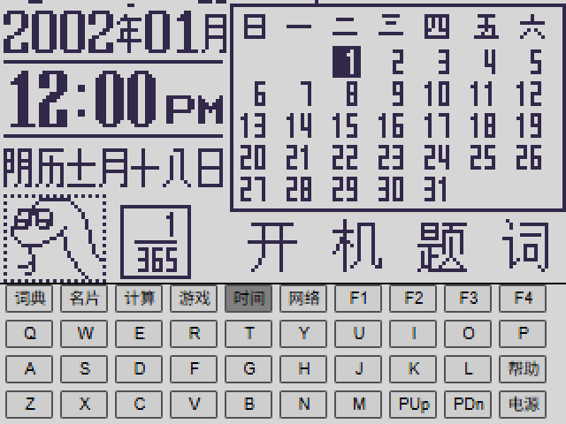

This project adapts the WQX NC1020 emulator for GameShell. It uses [hackwaly's jswqx](https://github.com/hackwaly/jswqx), packages it with NW.js and supplies a GameShell launcher.

The window fits GameShell's 320 × 240 screen: the 320 × 160 LCD on top, and below it a virtual keyboard with the NC1020's keys (dictionary, calculator, games, letters, Page Up/Down, power and more), since GameShell has no keyboard of its own.

- **Select** opens or closes the virtual keyboard; the **D-pad** moves through it, and **A** presses the selected key.
- With the keyboard closed, **A** is Enter and the D-pad works as the arrow keys.
- **B** is the AC (clear) key, **Start** is Caps Lock, and **Menu** quits.

The repository documents where to place the application and how to adjust the launcher when the GameShell account name differs from the default. My contribution is the handheld integration; the emulator and contributed icon assets retain their original authorship.
