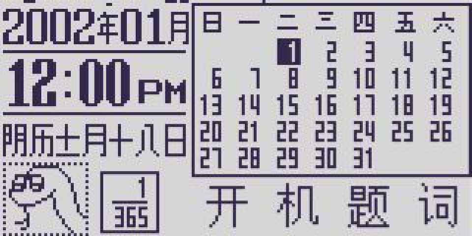

这个项目把文曲星 NC1020 模拟器适配到了 GameShell 上。它基于 [hackwaly 的 jswqx](https://github.com/hackwaly/jswqx)，用 NW.js 打包，并提供了一个 GameShell 启动器。

仓库里写了应用该放在哪个位置，以及当 GameShell 的账户名和默认的不一样时，启动器要怎么改。我做的是掌机上的集成部分；模拟器本身和别人贡献的图标素材，作者仍是原作者。
